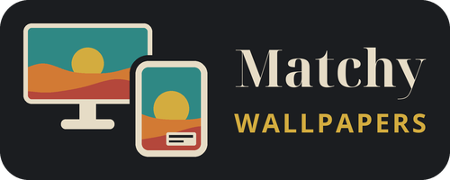
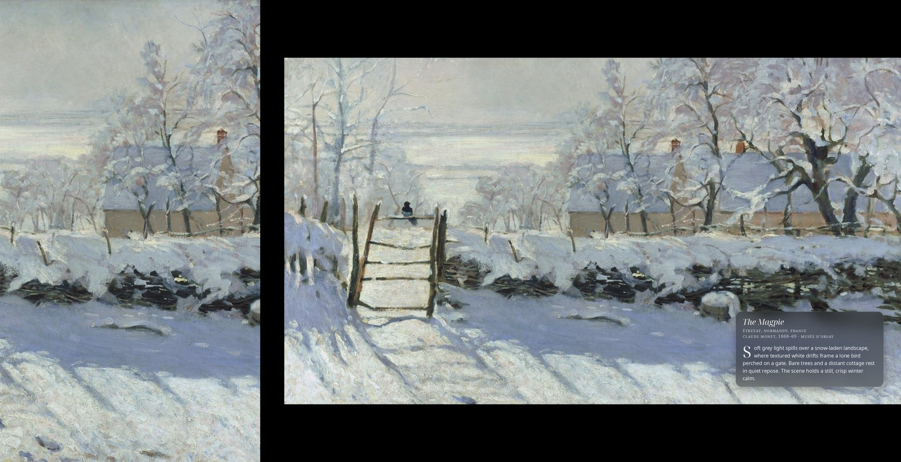
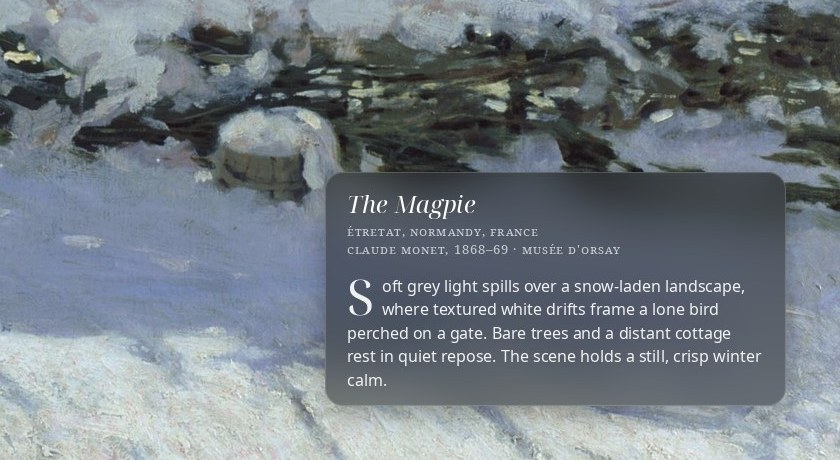
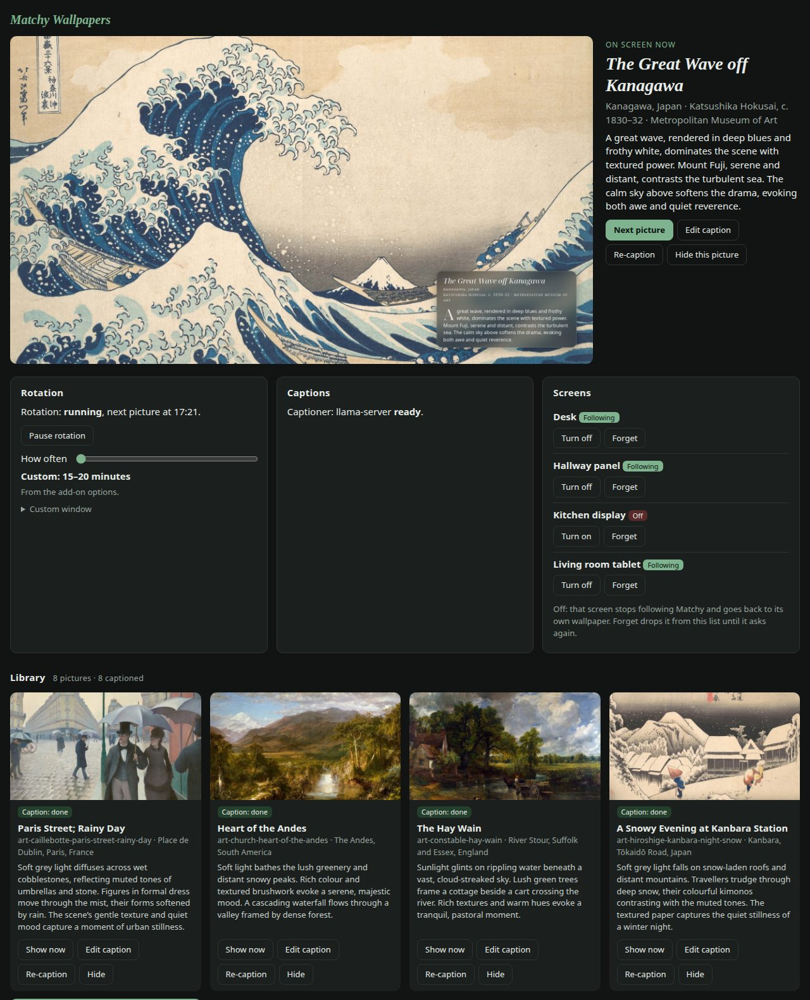

<strong>One wallpaper, matched across every screen.</strong>

Matchy Wallpapers (Matchy for short) picks one picture for the whole house and gives every screen that
same picture, rendered to its own shape and size: a spanned composite across a multi-monitor desktop,
a portrait crop on a wall tablet, a dashboard background in a browser. Each picture carries an
art-gallery label baked into the corner: title, credit, and a short blurb written by a vision model you
point it at, grounded on the metadata you already have.

It is a Home Assistant add-on, and one small Python service underneath (standard library HTTP server
plus Pillow) that also runs on plain Docker. No account, no cloud, no telemetry: it reads your folders
and serves your pictures on your own network.

## What it does

- **One picture everywhere.** Every screen asks for the size it wants and gets that picture cut to
  fit; a desktop gets one composite spanning all its monitors, matched to the live layout.
- **Gallery labels.** A 30 to 45 word blurb per picture from any OpenAI-compatible vision model
  (llama.cpp, Ollama, LM Studio or a cloud API), written once and kept. A blurb that names something
  that is not in the picture's known facts is rejected and asked for again. Without a model, the
  label shows the title and credit.
- **Rotation to taste.** Every 15 to 20 minutes by default; the panel's slider goes from every 15
  minutes to every 12 hours, or one picture at sunrise and the next at sunset where you live.
  Optional quiet hours hold one dimmed picture overnight.
- **Mood-aware picks**, if you want them. The captioner tags each picture (night, rain, forest,
  cosy…) and the weather, the season and the time of day pull matching pictures forward: cosy on a
  cold wet evening, bright on a sunny morning. The whole library still rotates.
- **A screens list.** Every screen that names itself shows up in the panel, where you can turn it off
  (it goes back to its own wallpaper) or on again.
- **Colour match.** Each picture's main colours, a usable accent and the nearest GNOME accent name,
  shown as swatches in the panel and served with the picture, so a desktop's accent colour, a
  dashboard theme or the lights can follow it.
- **A sidebar panel** in Home Assistant: next, pause, show any picture now, hide one, edit or redo a
  caption.

## Install

### Home Assistant add-on

1. Add `https://github.com/adrutu/matchy-wallpapers` under **Settings → Add-ons → Add-on store → ⋮ →
   Repositories** (newer releases say *Apps*), or use the button above.
2. Install **Matchy Wallpapers**. Home Assistant builds it on your machine (no pre-built image is
   published): about a minute on a PC, longer on a Raspberry Pi.
3. Put pictures in `/media/wallpapers` (or point `source_folders` elsewhere under `/media` or
   `/share`) **before** the first start, then start it and turn on **Show in sidebar**.
4. Optional: add a captioner in the options, and publish the port in the **Network** section so
   desktops, tablets and dashboards can follow the picture.

Every option, the HTTP API, the access tiers and troubleshooting: [matchy/DOCS.md](matchy/DOCS.md).

### Docker, without Home Assistant

The same image runs anywhere Docker does; you start the engine directly with a `config.json` instead
of the add-on's start script: [matchy/DOCS.md](matchy/DOCS.md#running-it-without-home-assistant).
Build it from this repository (`docker build -t matchy ./matchy`).

## Clients

Short recipes, not separate programs, under [docs/clients/](docs/clients/):

- **GNOME desktop**: a user service that follows the picture and sets a spanned wallpaper matched to
  your live monitor layout, label on the primary screen; optionally the desktop's accent colour too.
  [gnome.md](docs/clients/gnome.md)
- **Home Assistant dashboards and wall tablets**: entities for the picture, a card-mod view
  background that follows the rotation, a Wallpanel screensaver with the label, one on/off switch
  per tablet, and the picture's accent for the theme and the lights.
  [home-assistant.md](docs/clients/home-assistant.md)
- **Home Assistant Assist**: ask a voice satellite *what's on the wall?* and it reads the label; *next
  wallpaper*, *pause the wallpaper* and *I love this wallpaper* by voice.
  [home-assistant-assist.md](docs/clients/home-assistant-assist.md)
- **Homepage dashboard**: a background that follows the rotation, plus a tile.
  [homepage.md](docs/clients/homepage.md)
- **Anything else**: `curl` examples for the API. [curl.md](docs/clients/curl.md)
- **Any browser on your network**: the gallery page itself.

## Requirements

- Home Assistant OS or Supervised on **amd64** or **aarch64** (a Raspberry Pi 4 or 5 on the 64-bit
  OS is plenty), or any machine that runs Docker.
- Pictures of your own. JPEG, PNG or WebP, up to 50 megapixels.
- Optional: an OpenAI-compatible vision endpoint for the blurbs.

## Status

It has run every day in one house since October 2026: a multi-monitor GNOME desktop, two wall
tablets and a Homepage dashboard, captioned by a local 8B vision model. The image builds and renders
identically on amd64 and aarch64 in CI. The HTTP API is documented but may still change before 1.0.

## Limitations

- The published port has no login. Anyone who can reach it sees every picture and caption; the
  controls that change the library work only from the sidebar panel. Keep it on your own network.
- As an add-on, pictures must live under `/media` or `/share`.
- One rotation for the whole house: no per-screen pictures.
- The engine runs as root inside its container, as Home Assistant add-ons do.

## Development

- `tests/run_tests.py`: integration tests against the real engine (rotation, panel controls, access
  tiers, screens, quiet hours, request bodies, oversized images). `uv run --with pillow python tests/run_tests.py`,
  or any Python 3 with Pillow; about a minute.
- `tests/caption_test.py` (the grounding check), `tests/mood_test.py` (the moment's tags and the
  weighting of the picks), `tests/render_test.py` (crops for every picture shape and client size) and
  `tests/run_sh_test.py` (`run.sh` turning add-on options into `config.json`, bashio stubbed by jq).
- `tests/validate_config.py`: `config.yaml` and `translations/` against the Home Assistant
  Supervisor's own schema at a pinned release.
- `tests/label_diff.py` and `tests/ci_probe.py`: the label rendered inside each built image and
  compared across architectures.
- `.github/workflows/build.yml`: lint, all of the above, and an amd64 and an aarch64 image build.
  Publishing images is opt-in and off.
- `tools/retro_themes.py` draws 24 original striped wallpapers in four retro palettes (Pillow and
  numpy), each folder with a `meta.json`; give each folder a `sets` entry with `abstract: true`.
  `tools/make_artwork.py` draws the icon and logo.
- Decisions made so far: [docs/DECISIONS.md](docs/DECISIONS.md).

## Credits

Made by Andrei Drutu, with [Claude Code](https://claude.com/claude-code), Anthropic's coding agent,
as co-developer: it wrote most of the code, tests and documentation to his direction and review, and
the commits it worked on say so. Some first drafts came from local Qwen models through opencode.

## Licence

Code: MIT, see [LICENSE](LICENSE). The bundled fonts are Noto, under the SIL Open Font Licence 1.1,
and their licence travels with the image. No pictures ship with Matchy; the ones you point it at stay
yours, and their licences are your business. The paintings in the screenshots are public domain
(Monet's *The Magpie*, and in the panel Hokusai, Constable, Church, Hiroshige, Caillebotte, Turner and
Van Gogh).
